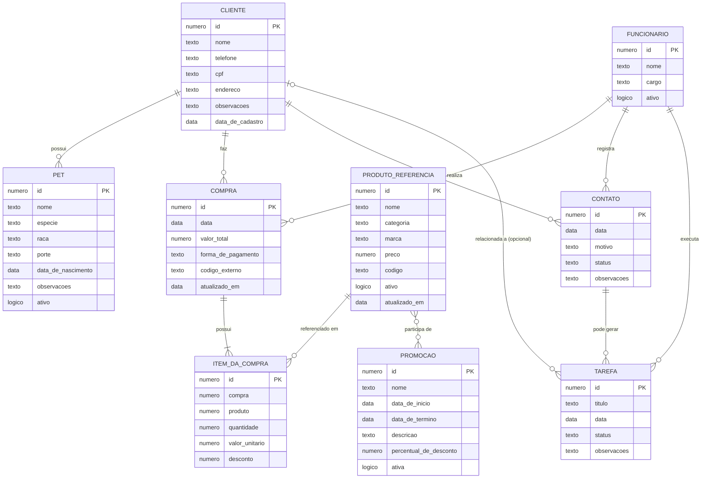
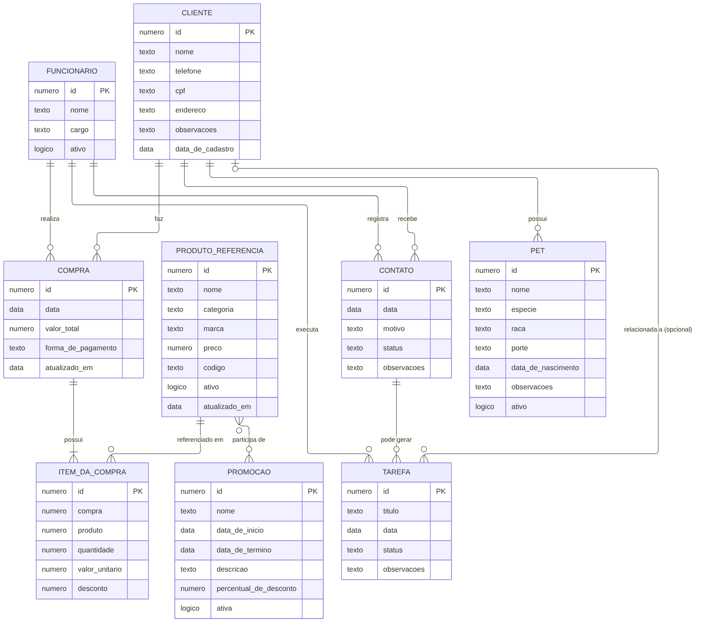

# DER — Diagrama Entidade-Relacionamento (conceitual)

Versão atual, **com a entidade `Pet`**. O diagrama usa a sintaxe [Mermaid](https://mermaid.js.org/), que o GitHub renderiza automaticamente. Por ser texto, cada mudança aparece no histórico do Git, linha a linha.

**Como ler a notação de cardinalidade:** `||` = exatamente um · `o|` = zero ou um · `o{` = zero ou muitos · `|{` = um ou muitos.

> Os tipos mostrados (`numero`, `texto`, `data`, `logico`) são genéricos, de propósito: os tipos exatos do PostgreSQL (`VARCHAR`, `NUMERIC`, `TIMESTAMPTZ`...) são definidos na etapa seguinte, no Dicionário de Dados.

## Relacionamentos

| Entidade A | Cardinalidade | Entidade B | Leitura |
|---|---|---|---|
| Cliente | 1:N | **Pet** *(novo)* | Um cliente possui zero ou mais pets; cada pet pertence a exatamente um cliente. |
| Cliente | 1:N | Compra | Um cliente faz várias compras; cada compra é de um cliente. |
| Funcionário | 1:N | Compra | Um funcionário realiza várias compras (vendas); cada compra tem um funcionário responsável. |
| Compra | 1:N | Item da Compra | Uma compra tem um ou mais itens; cada item pertence a uma compra. |
| Produto Referência | 1:N | Item da Compra | Um produto pode aparecer em vários itens; cada item refere-se a um produto. |
| Produto Referência | N:N | Promoção | Um produto pode estar em várias promoções e uma promoção pode envolver vários produtos. |
| Cliente | 1:N | Contato | Um cliente pode receber vários contatos. |
| Funcionário | 1:N | Contato | Um funcionário registra vários contatos. |
| Contato | 1:N | Tarefa | Um contato pode gerar várias tarefas. |
| Funcionário | 1:N | Tarefa | Um funcionário executa várias tarefas. |
| Cliente | 1:N (opcional) | Tarefa | Uma tarefa pode, ou não, estar relacionada a um cliente. |

## Notas

- **O que mudou nesta versão:** entidade `Pet` e relacionamento Cliente 1:N Pet. Padronizado o nome `Tarefas` → `Tarefa` (singular, como as demais entidades). A relação Compra → Item da Compra passou a `|{` (um ou muitos), fiel ao DER original, em que uma compra sempre tem ao menos um item.
- **Atributos opcionais do Pet:** `nome`, `especie`, `raca`, `porte`, `data_de_nascimento` e `observacoes` são opcionais (ver [Requisitos](requisitos.md)). O DER conceitual não mostra obrigatoriedade; ela é registrada no [Dicionário de Dados](dicionario-de-dados.md).
- **Relacionamento N:N (Produto Referência × Promoção):** no modelo lógico ele se transforma na tabela associativa `produto_promocao`, definida no [Dicionário de Dados](dicionario-de-dados.md). A primeira versão do desenho indicava "zero ou um" no lado Promoção; a cardinalidade correta é "zero ou muitos" nos dois lados, pois um produto pode participar de várias promoções ao longo do tempo.
- **Atributo `codigo_externo` em Compra (acrescentado):** identificador da venda no sistema Open, que permite referenciar a venda de origem e evitar registros duplicados. Não constava na primeira versão do DER.
- **Atributos `compra` e `produto` em Item da Compra:** no DER original eles já aparecem como atributos; no modelo lógico serão as chaves estrangeiras que ligam o item à compra e ao produto.
- **Em aberto (não alterado nesta revisão):** a obrigatoriedade das relações Contato → Tarefa e Cliente → Tarefa (uma tarefa pode existir sem contato de origem?) será confirmada quando chegarmos na entidade Tarefa.
- **Imagem do diagrama:** [`der.png`](der.png) é uma imagem gerada a partir do diagrama deste arquivo, já com a entidade `Pet`. Se o diagrama mudar, este arquivo (`der.md`) é a referência: a imagem deve ser gerada de novo a partir dele.

