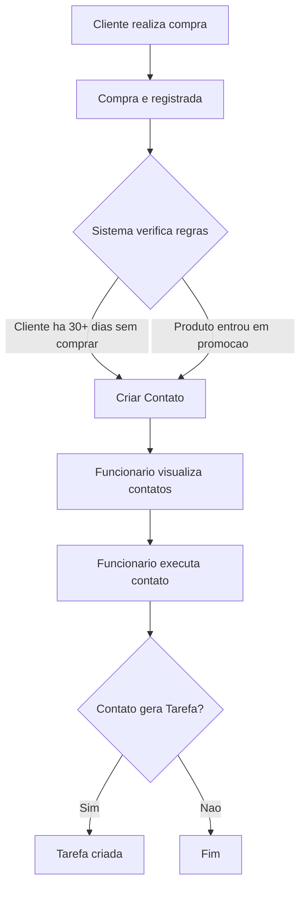

# Fluxo de Uso

## Navegação do funcionário

1. Cadastrar cliente
2. Pesquisar cliente
3. Consultar histórico de compras
4. Consultar produtos em promoção
5. Verificar aba de notificações
6. Realizar contato com o cliente

## Regra de geração de contato

O diagrama abaixo usa a sintaxe [Mermaid](https://mermaid.js.org/), que o GitHub renderiza automaticamente como um fluxograma ao exibir este arquivo — não precisa exportar imagem.

