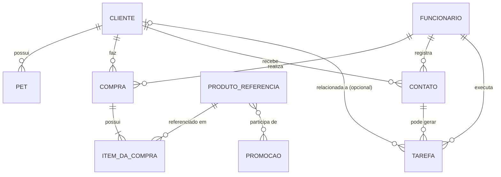

# Modelo de Domínio

## Diagrama de relacionamentos

O GitHub renderiza este diagrama automaticamente (sintaxe [Mermaid](https://mermaid.js.org/), tipo `erDiagram`). Notação de cardinalidade: `||` = exatamente um, `o{` = zero ou muitos, `|{` = um ou muitos, `o|` = zero ou um.

Para ver os atributos de cada entidade, consulte o [DER](der.md).

## Entidades

| Entidade | Representa |
|---|---|
| Cliente | Quem compra no pet shop. |
| Pet | Animal de estimação de um cliente. Um cliente pode ter vários pets; cada pet pertence a um único cliente. |
| Produto Referência | Itens vendidos (ração, medicamentos, brinquedos etc.) — catálogo de referência, sem controle de estoque. |
| Compra | Uma venda registrada no sistema Open, referenciada aqui para fins de CRM. |
| Item da Compra | Cada produto que fez parte de uma compra. |
| Funcionário | Quem realizou o atendimento/venda. |
| Contato | Lembrete/oportunidade de contato com um cliente. |
| Promoção | Campanha promocional que pode envolver um ou mais produtos. |
| Tarefa | Atividade que um funcionário precisa executar (ex.: ligar para um cliente). |

## Notas de revisão

- **2026-10-24 — Entidade `Pet` incorporada.** Antes estava marcada como pendente. A relação Cliente 1:N Pet resolve o requisito "quantidade e nome dos pets" sem guardar listas dentro de um único campo do Cliente (1ª Forma Normal). A quantidade de pets é calculada contando os registros de Pet, não é armazenada.
- **2026-10-24 — Compra → Item da Compra** ajustada para "um ou muitos" (`|{`), fiel ao DER original: toda compra tem ao menos um item.
- **2026-10-24 — `Tarefas` → `Tarefa`:** nome padronizado no singular, como as demais entidades.
- Padronizado "Produto" → "Produto Referência" em todos os documentos, para manter consistência com o DER e com a decisão da Opção A (catálogo de consulta, sem controle de estoque).
- Adicionada a relação `Contato → Tarefa`, que não estava no diagrama de texto original, mas já aparece no Fluxo de Uso ("Contato pode gerar uma Tarefa") e no DER.
